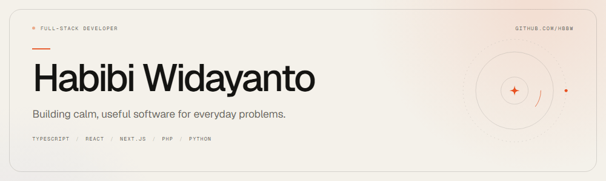

  <picture>
    <source media="(prefers-color-scheme: dark)" srcset="./assets/hero-dark.gif">
    <source media="(prefers-color-scheme: light)" srcset="./assets/hero-light.gif">
    
  </picture>

Full-stack developer. I turn spreadsheets and group chats into web apps that do the job properly.

I like the moment a messy manual process becomes a screen that tells someone what to do next. Most of my work covers the whole path: query, API, interface, deployment.

**Now** · Building [CR Monitor](https://github.com/HBBW/cost-reductions), a cost-reduction dashboard that replaced a manual Excel workflow.

## Selected work

**[KampungOS](https://github.com/HBBW/kampungOS)** · MIT  
Digital administration for RT/RW: letters, reports, announcements, and one account per household.  
`PHP` `CodeIgniter` `Tailwind CSS`

**[CR Monitor](https://github.com/HBBW/cost-reductions)**  
Central cost-reduction monitoring. Actual CR is computed from budget and actuals, department status is visible in real time, and reports download on demand.  
`Angular` `Express` `MySQL` `SQL Server`

**[Nom Yum](https://nom-yum.vercel.app)** · Live  
A small app for the daily "what should we eat?" question, with a 3D food scene.  
`Next.js` `React` `Three.js` `Tailwind CSS` · [Source](https://github.com/HBBW/nom-yum)

**[CCTV Monitoring](https://github.com/HBBW/cctv-monitoring)**  
Exception-based CCTV monitoring: a Laravel API, React dashboard, visual evidence uploads, role-based access, and CSV/PDF exports.  
`Laravel` `React` `MySQL`

## Toolkit

**Interface**  
TypeScript · React · Next.js · Angular · Tailwind CSS · Three.js

**Server**  
PHP · Laravel · CodeIgniter · Node.js · Express · Python

**Data & delivery**  
MySQL · SQL Server · Git · Vercel

## How I build

- **Compute, don't copy.** In CR Monitor, cost reduction is never stored; it is derived from budget and actuals, so the number cannot quietly drift.
- **Surface what is missing.** CR Monitor is built around a per-department, per-month completeness screen, so gaps are visible before the deadline rather than after.
- **Put constraints on the server.** Roles, deadlines, and corrections are enforced where they cannot be bypassed by a refresh.

## Say hello

If you have a process that lives in a spreadsheet, I'd like to hear about it.

[Open an issue](https://github.com/HBBW/HBBW/issues/new) · [All repositories](https://github.com/HBBW?tab=repositories)

Hero rendered with [Remotion](https://www.remotion.dev). Type set in Geist and Geist Mono. Banner source in [`motion/`](./motion).
